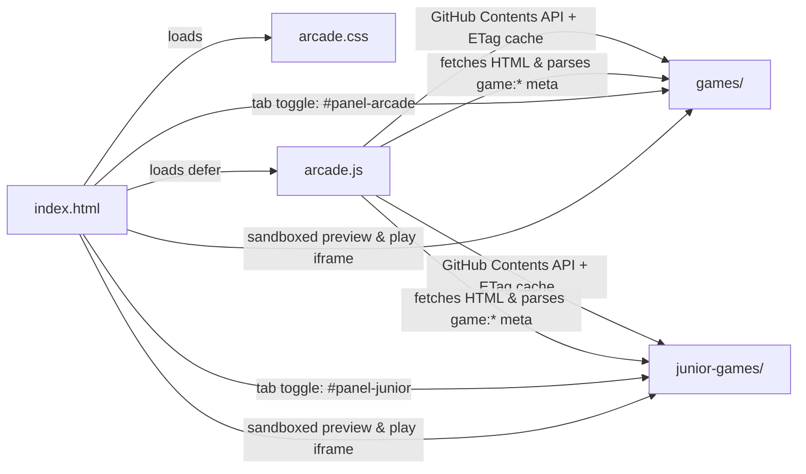

# Implementation Overview

> **Thin context layer.** The code in this repository is always the source of truth. This document provides only high-level structure and cross-file relationships so contributors and LLMs can orient quickly.

## What This Repo Contains

`retro-games` is a zero-build, static browser arcade designed to run directly on GitHub Pages (or any static server). Every game is a self-contained single-file HTML document (inline CSS + JS, Canvas/WebAudio, no bundler or runtime dependencies).

## Top-Level Layout

```text
.
├── index.html                   # Landing page shell (Retro Arcade + Junior Arcade spaces)
├── arcade.css                   # Visual theme, layout, tab switcher, cabinet grid, overlay styles
├── arcade.js                    # Dynamic game discovery, caching, filtering, sorting, play overlay
├── games/                       # Classic arcade HTML games (Retro Arcade section)
├── junior-games/                # Toddler-friendly HTML games (Junior Arcade section)
│   ├── audio/                   # Shared phonics audio module + cached British English .m4a clips
│   └── images/                  # Shared phonics SVG loader + 29 vector object/scene illustrations
├── docs/
│   ├── index.md                 # Graph-style node/edge index of repo elements
│   └── implementation/
│       └── overview.md          # This high-level architecture overview
├── AGENTS.md                    # Instructions for AI agents using & maintaining docs
├── README.md                    # Short repository description
└── LICENSE                      # MIT license
```

## How the Pieces Relate



### 1. Landing Page Shell (`index.html`, `arcade.css`, `arcade.js`)
- **`index.html`** defines the page chrome (Pac-Man chase header, accessible `tablist` toggle between **Retro Arcade** and **Junior Arcade**, shared Search/Filter/Sort controls, two dedicated `tabpanel` containers `#panel-arcade` and `#panel-junior`, full-screen play overlay `.play`, and `<dialog class="details">`).
- **`arcade.css`** owns the retro neon dark theme, Pac-Man chase animation, Junior Arcade candy-accented styling (`body[data-section="junior"]`, `.junior-hero`, `.grid--junior`), responsive cabinet grid, and reduced-motion rules.
- **`arcade.js`** powers all dynamic behavior:
  - **Repo auto-detection**: resolves `owner/repo` from `?repo=owner/repo`, `CONFIG.owner`/`CONFIG.repo`, or `*.github.io` URLs.
  - **Multi-section discovery**: reads `CONFIG.sections` (`arcade` -> `games`, `junior` -> `junior-games`) in parallel via the GitHub Contents API, caching directory listings in `localStorage` (`retroArcade:v1:dir:...`) with ETag revalidation and per-file metadata by blob SHA (`retroArcade:v1:meta:<sha>`).
  - **Per-section state**: each section maintains independent search, genre/tag filters, sort state, count badge, and empty/status messages. Switching tabs updates `aria-selected`, `hidden="until-found"`, `document.body.dataset.section`, `document.title`, and URL hash (`#junior`).
  - **Lazy previews & play overlay**: an `IntersectionObserver` mounts sandboxed preview `<iframe>` elements only for visible cards in the active section. Clicking a card opens `.play` with fullscreen support and `#play=<section>/<filename>` deep-linking (plus legacy `#play=<filename>` fallback).

### 2. Game Folders (`games/` and `junior-games/`)
- **`games/`** holds classic retro arcade cabinets displayed under the **Retro Arcade** tab.
- **`junior-games/`** holds toddler- and preschool-friendly games (big targets, gentle pace, cheerful audio) displayed under the dedicated **Junior Arcade** tab.
- Both folders share the same **Single-File Game Contract** (with one intentional shared-asset exception: the toddler phonics games in `junior-games/` load `junior-games/audio/phonics-audio.js`, cached `.m4a` voice clips under `junior-games/audio/phonics/`, `junior-games/images/phonics-images.js`, and `.svg` illustrations under `junior-games/images/phonics/`; `arcade.js` filters strictly for top-level `.html` files, so subfolders and shared assets do not appear as gallery cards):
  - One standalone `.html` file per game; no external build step.
  - Full-viewport, zero-scrollbar layout so it scales cleanly inside preview and play `<iframe>`s.
  - Metadata in `<head>` read by `parseGameHtml()` in `arcade.js`:
    - `<title>` — Display name
    - `<meta name="description">` — Short cabinet blurb
    - `<meta name="game:genre">` — Category for filtering/accent fallback
    - `<meta name="game:tags">` — Comma-separated lowercase tags
    - `<meta name="game:added">` — ISO date (`YYYY-MM-DD`) for Recent sort
    - `<meta name="game:year">` — Original/release year
    - `<meta name="game:controls">` — Control instructions shown in Game Info
    - `<meta name="game:author">` — Creator credit
    - `<meta name="game:color">` — Hex accent color (`#rrggbb`)

### 3. Documentation & Agent Layer (`docs/`, `AGENTS.md`)
- **`docs/index.md`** maps every file, directory, game, and key symbol as graph nodes and edges so LLMs can jump directly to exact paths without speculative grepping.
- **`docs/implementation/`** holds thin architectural context like this file.
- **`AGENTS.md`** tells agents to consult `docs/index.md` first and keep both `docs/index.md` and `docs/implementation/` lightly synchronized after structural changes.
